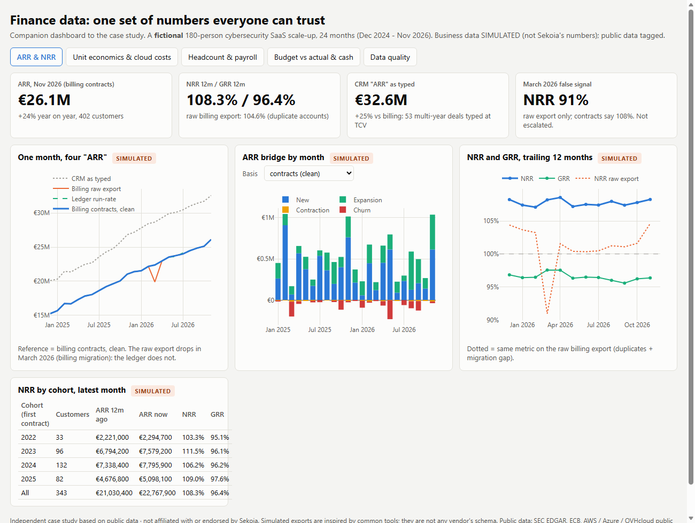

# Sekoia: one set of Finance numbers everyone can trust

**[Report (PDF)](https://albt-france.github.io/sekoia-finance-data-case-study/report/Sekoia_Finance_Data_CaseStudy.pdf) · [Interactive dashboard](https://albt-france.github.io/sekoia-finance-data-case-study/dashboard/finance_data_dashboard.html)**

**Mapping, reconciling and explaining the data of a cybersecurity SaaS.** An independent case study for the *Finance Data Analyst - SaaS*
role posted by Sekoia (19 Nov 2026).

> Sekoia's internal figures are not public, so none is used or guessed here. The analysis runs on a **fictional 180-person
> cybersecurity SaaS scale-up** (about 400 customers, 24 months, Dec 2024 - Nov 2026), **SIMULATED** on top of **real public data**
> (cloud unit prices, ECB exchange rates, French public holidays, SEC 10-K benchmarks). Exports are *inspired by* the tools named in the
> job post; they are not the real schema of any vendor and not Sekoia's data.
>
> Independent case study based on public data · not affiliated with or endorsed by Sekoia.

| Deliverable | Link |
|---|---|
| Report, 8 pages (PDF) | [`report/Sekoia_Finance_Data_CaseStudy.pdf`](report/Sekoia_Finance_Data_CaseStudy.pdf) |
| Interactive dashboard (one HTML file, offline) | [`dashboard/finance_data_dashboard.html`](dashboard/finance_data_dashboard.html) |
| Finance reporting pack (Excel, live formulas, self-audit sheet) | [`excel/finance_reporting_pack.xlsx`](excel/finance_reporting_pack.xlsx) |
| Metabase native SQL questions (5 tabs) | [`metabase/`](metabase/) |
| Analysis notebook | [`notebooks/analysis.ipynb`](notebooks/analysis.ipynb) |
| Data map and lineage | [`docs/DATA_MAP.md`](docs/DATA_MAP.md) |
| Metric definitions (ARR, NRR, headcount, COGS...) | [`docs/METRIC_DEFINITIONS.md`](docs/METRIC_DEFINITIONS.md) |
| Reconciliations (rules, thresholds, results) | [`docs/RECONCILIATIONS.md`](docs/RECONCILIATIONS.md) |
| Data issues log | [`docs/DATA_ISSUES_LOG.md`](docs/DATA_ISSUES_LOG.md) |
| Prioritised data backlog | [`docs/DATA_NEEDS_BACKLOG.md`](docs/DATA_NEEDS_BACKLOG.md) |
| Monthly close checklist (D+1 to D+5) | [`docs/MONTHLY_CLOSE_CHECKLIST.md`](docs/MONTHLY_CLOSE_CHECKLIST.md) |
| HR and payroll confidentiality rules | [`docs/DATA_CONFIDENTIALITY.md`](docs/DATA_CONFIDENTIALITY.md) |



## Question
In a growing cybersecurity SaaS, why do ARR, headcount and costs give a different number in each tool, which definitions should hold,
and what do the reconciled numbers say about growth and margin?

## Four results (SIMULATED company)
1. **ARR has three values, one is the reference.** November 2026: CRM €32.6M, billing contracts €26.1M, ledger run-rate €26.1M. The
   €6.5M gap is fully explained: 53 multi-year deals typed at total contract value (€6.25M), CRM amounts before the last discount,
   4 closed-won deals without a contract. Residual: €0.
2. **The March 2026 "churn" was a false signal.** The raw billing export showed ARR -€2.5M and NRR 91%: the billing migration closed
   40 renewal lines one day early. Contracts and ledger did not move (NRR 108%). Not escalated; a gap rule and a test now catch it.
3. **Growth holds: NRR 108.3%, GRR 96.4%, ARR +24% a year.** Twelve duplicate billing accounts had pulled NRR down to 104.6% on raw data.
4. **Retention costs money.** Three flat-fee customers keep logs 365 days instead of 120 without repricing: their storage cost tripled
   and their gross margin went from +42% to -40% (company gross margin 80.8%; listed peers 70-78%, 10-K). On AWS, 40% of the cost rise
   over the last three months is the dollar, not usage; 18% of cloud resources have no tag since the AI launch.

## What is inside
- `src/fetch_public.py` - public data (SEC EDGAR, AWS / Azure / OVHcloud prices, FOCUS v1.4 column list, ECB, Nager.Date, company register).
- `src/simulate_company.py` - 12 simulated exports (CRM, billing, ledger, treasury, budget, HRIS, payroll, expenses, ATS, AWS / Azure / OVH bills in FOCUS columns) and product usage, seed 42, with 8 planted data problems.
- `sql/` - DuckDB warehouse in layers: `staging/` (one view per system), `intermediate/` (customer key, annualised contracts, 3 headcount definitions, cloud costs in EUR with an allocation rule), `marts/` (ARR bridge, NRR by cohort, unit economics, gross margin, budget vs actual, price / volume / FX, cash, reconciliations), `tests/` (23 tests).
- `src/run_tests.py` - prints OK / KO for each test (uniqueness, nulls, balanced entries, reconciliation thresholds, confidentiality).
- `src/build_excel.py`, `src/build_dashboard.py`, `src/charts.py` + `src/build_pdf.py` - workbook, dashboard and report, all read from the marts.

## How to rerun
Python 3.10+, no API key, no account.
```
pip install -r requirements.txt
python src/fetch_public.py
python src/simulate_company.py
python src/run_sql.py
python src/run_tests.py
python src/facts.py
jupyter nbconvert --to notebook --execute --inplace notebooks/analysis.ipynb
python src/build_excel.py
python src/build_dashboard.py
python src/build_pdf.py
```
`build_pdf.py` prints the report with Microsoft Edge or Google Chrome in headless mode. `python src/build_excel.py --verify`
recalculates a copy of the workbook with LibreOffice and prints the self-audit sheet.

## Methods
- **One customer key**: billing accounts grouped on the VAT number, normalised names checked, CRM id carried over.
- **ARR from contracts**, lines active on the last day of the month; a gap of 1 to 7 days between two lines of the same customer and product is a renewal, not churn.
- **Reconciliations as cascades**: each difference classified (definition, timing, data entry, real gap) with a threshold (1% CRM vs billing, 0.5% ledger checks).
- **Unit economics**: cloud costs at public unit prices (AWS eu-west-3, Azure France Central, OVHcloud FR), FOCUS v1.4 columns, USD converted at the ECB monthly average; costs allocated by stored GB, ingestion, AI queries, segment weight and ARR.
- **Price / volume / FX**: `EUR = list USD x (1 - discount) / USD per EUR`, three effects that add up exactly.
- **Confidentiality**: payroll aggregated, no group under 5 people, pseudonymous ids, tested.
- AI-assisted workflow: I used Claude, mainly to write scripts faster. I drove the project: I defined the questions, chose and validated the data sources, made the analytical decisions and checked every result.

## Sources and licences (read 19-20 Nov 2026)
| Source | Use | Terms |
|---|---|---|
| Sekoia website (`sekoia.com/about`) and job post (`careers.sekoia.com`) | facts quoted "as stated by Sekoia" | quoted with link and date |
| French company register API (`recherche-entreprises.api.gouv.fr`) | legal identity only (no officers stored) | Licence Ouverte / Etalab 2.0 |
| SEC EDGAR XBRL company facts (CrowdStrike, SentinelOne, Rapid7, Tenable) | 10-K gross margin, R&D, S&M, deferred revenue | US public filings |
| AWS Price List API (eu-west-3), Azure Retail Prices API (francecentral), OVHcloud public catalog (FR) | unit prices for storage, compute, AI tokens | public price lists |
| FOCUS specification v1.4 (FinOps Foundation, GitHub) | column names of the cloud cost export | specification licence of the FinOps Foundation |
| ECB Data Portal, USD/EUR monthly averages | FX conversion and FX effect | ECB reuse policy, source quoted |
| Nager.Date public holidays API | close calendar (D+1 to D+5 working days) | MIT |

## Limits
- All company data is simulated: patterns are realistic, levels are not Sekoia's. The 8 problems were planted, so finding them proves the method, not a fact about any company.
- Exports are simplified (no VAT flows in cash, monthly ratable revenue, one entity, one currency besides USD cloud bills).
- Public prices are list prices; real contracts carry discounts (a flat 10% AWS discount is assumed).
- SEC benchmarks are large listed vendors with their own COGS definitions: reference points, not targets for a scale-up.
- The Metabase questions were run on DuckDB, not in a Metabase instance.
