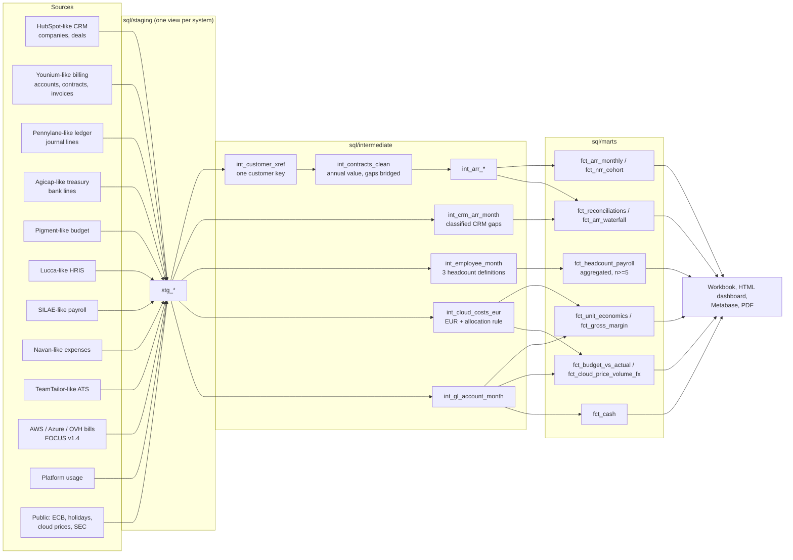

# Data map: twelve systems, one Finance view

> SIMULATED. The company is a **fictional 180-person cybersecurity SaaS scale-up**. The tool names below are the ones listed
> in Sekoia's public job post (as stated by Sekoia, read 19 Nov 2026); the exports in `data/sim/` are **inspired by** common
> exports of such tools. They are not the real schema of any vendor and contain no Sekoia data.

## 1. Systems, owners, grain and keys

| # | Domain | Tool named in the job post | Simulated export | Grain | Business owner (role) | Refresh | Join keys |
|---|---|---|---|---|---|---|---|
| 1 | CRM / RevOps | HubSpot | `crm_companies`, `crm_deals` | company; deal | RevOps Manager | daily | `crm_company_id`, `deal_id` |
| 2 | Billing / subscriptions | Younium | `billing_accounts`, `billing_contracts`, `billing_invoices` | account; contract line; invoice | Head of Finance (billing ops) | daily | `billing_account_id`, `contract_id`, `crm_deal_id`, `vat_number` |
| 3 | Accounting | Pennylane | `gl_entries` | journal line | Head of Finance | daily, closed monthly | `account`, `document_ref` (= invoice id), `analytic_code` |
| 4 | Treasury | Agicap | `cash_transactions` | bank line | Head of Finance | daily | `reference` |
| 5 | Planning | Pigment | `budget_2026` | month x budget line | Finance Data Analyst (data owner in Pigment) | frozen Dec 2025, re-forecast quarterly | `gl_account`, `department` |
| 6 | HRIS | Lucca | `hris_employees` | employee | People team | daily | `employee_id` |
| 7 | Payroll | SILAE | `payroll_monthly` | payslip | People team / payroll provider | monthly (D+3 after pay day) | `employee_id`, `pay_month` |
| 8 | Travel and expenses | Navan | `expenses` | expense line | Head of Finance | daily | `employee_id`, `trip_tag` |
| 9 | Recruiting | TeamTailor | `ats_requisitions` | requisition | People team | daily | `department` |
| 10-12 | Cloud bills | AWS, Azure, OVHcloud invoices | `cloud_costs_focus` (FOCUS v1.4 columns) | resource x month | FinOps Manager | daily (cost exports), monthly (invoice) | `InvoiceId`, `ResourceId`, `Tags` |
| + | Product usage | platform (Data Engineering) | `customer_usage` | customer x month | Data Engineering | daily | `crm_company_id`, `tenant_id` |
| + | Reporting | Metabase | `metabase/` queries on the marts | dashboard | Finance Data Analyst | after each load | marts |

Public reference data: ECB USD/EUR monthly rates, French public holidays (Nager.Date), AWS / Azure / OVHcloud public unit prices,
SEC 10-K figures of four listed security vendors (see README, Sources).

## 2. Flows and lineage

## 3. How the systems join (and where they break)

| From | To | Key | Known break | Rule applied |
|---|---|---|---|---|
| CRM deal | billing contract line | `crm_deal_id` on the contract line | 4 closed-won deals with no contract (handover gap) | listed in the CRM vs billing reconciliation, owner RevOps Manager |
| billing account | CRM company | `crm_company_id` on the account | 12 accounts created at renewal without CRM id (name typed again) | group accounts on the VAT number, check the normalised name, carry the CRM id over |
| billing contract | ledger | invoice id = `document_ref` | invoices booked a month late (cut-off) | timing rule: a difference reversed the next month is explained |
| payroll | HRIS | `employee_id` | leavers without HRIS end date; final settlements paid the month after leaving | headcount needs a regular payslip; final settlements counted in "paid persons" only |
| payroll | ledger | month x department (`analytic_code`) | central accruals (bonus, paid leave) booked by Finance, not in payroll | accruals shown as reconciling items |
| cloud bill | ledger | `InvoiceId` = `document_ref` | bill booked the month after its service month; USD bills | EUR at ECB monthly average of the service month; timing rule |
| cloud resource | product / customer | `Tags.product` | 18% of resources untagged since the AI launch | allocation rule (AI service or "agents" resources -> AI), otherwise spread on ARR; tagging policy in backlog |
| usage | customer | `crm_company_id` | none | |
| bank | ledger | `reference` | a bank fee not yet booked | WARN status until booked |

## 4. Lineage of the published numbers

| Number | Mart | Built from | Reference source |
|---|---|---|---|
| ARR, customers, NRR, GRR | `fct_arr_monthly`, `fct_nrr_cohort` | `int_contracts_clean` <- `stg_billing_contracts` + `int_customer_xref` | billing contracts |
| Bookings | `int_crm_deal_lines` | `stg_crm_deals` (annualised) | CRM, checked against billing |
| Revenue | `fct_gross_margin` | ledger 706000 / 706100 / 709000 | ledger |
| COGS, gross margin | `fct_gross_margin`, `fct_unit_economics` | FOCUS costs (service month), ledger payroll (SOC Operations & Support), ledger 604500 | ledger + FOCUS |
| Headcount, FTE, payroll cost | `fct_headcount_payroll` | `int_employee_month` <- HRIS + payroll | HRIS for status, payroll for cost |
| Budget vs actual | `fct_budget_vs_actual` | Pigment budget + ledger | ledger |
| Cash, runway | `fct_cash` | bank export, tied to ledger 512000 | bank |
